<div align="center">

<p align="center">
  
</p>

# overkill

**The Frontier AI Harness That Has A Personality And Lets You Vibecode From Bed.**

[](https://go.dev/)
[](LICENSE-MIT)
[](https://github.com/Sahaj-Tech-ltd/overkill/wiki)

</div>

Overkill is a Go coding-agent backend with a terminal interface and a development desktop workspace. It supports configurable model providers, PostgreSQL session storage, local workflow files, and optional messaging integrations. Feature availability depends on the entry point and configured services; the development desktop is still being stabilized.

### desktop preview — v0.11.0-beta.2

Download the desktop app from [GitHub Releases](https://github.com/Sahaj-Tech-ltd/overkill/releases/tag/v0.11.0-beta.2):

| Platform | Desktop installer |
| --- | --- |
| macOS Apple Silicon | `Overkill-0.11.0-beta.2-development-arm64.dmg` |
| Windows x64 | `Overkill-0.11.0-beta.2-windows-x64-setup.exe` |

The preview includes chat/workspace UI, a private bundled database, peer-agent messages, automatic checkpoints, durable continuation, DAG memory, reviewed project skills and isolated `/think` items. Provider credentials are configured inside the app. The Mac build is ad-hoc signed and unnotarized; the Windows installer is unsigned. See the release notes and [distribution status](docs/RELEASING.md) for tested platforms and remaining limits. `overkill-windows-amd64.exe` is the separate terminal executable.

### terminal installation

```sh
curl -fsSL https://overkill.my/install | sh
```

Or with Go: `go install github.com/Sahaj-Tech-ltd/overkill/cmd/overkill@main`

---

### what it does

- **Model providers** — native adapters and OpenAI-compatible endpoints, with catalog-based model metadata and routing. Catalog entries do not prove credentials, model access, or live compatibility.
- **Persistent sessions and memory** — PostgreSQL stores conversation history and database-backed memory. Plans, tasks, tags, playbooks and other local workflow data also use files; see the [storage map](docs/src/architecture.md#storage).
- **Configurable personality** — bounded response-style and language instructions, with optional personality subsystems. Automatic long-term relationship tracking remains incomplete.
- **Messaging integrations** — Telegram, Discord, Slack, Matrix and Mattermost adapters; Signal through an external REST service; WhatsApp cloud and paired-device implementations; and an HTTP bridge for user-supplied sidecars. SMS and iMessage need external integrations; Feishu is not implemented. See the [capability and setup matrix](docs/gateways.md).
- **Checks and agent coordination** — actual post-write check results, peer messages, task budgets, blockers and contracts. Heuristic confidence is separate from test evidence; the full iterative self-evaluation loop remains unavailable.
- **Open application source** — MIT + Apache-2.0. Bundled dependencies have their own licenses and source obligations; see the [dependency inventory](docs/desktop-dependencies.md).

### what it isn't

- A complete production release yet. The [desktop development guide](desktop/README.md) describes the application bundle and its outstanding distribution gates; the [architecture notes](docs/src/architecture.md#availability-and-experimental-surfaces) describe unfinished surfaces.
- Another Claude Code clone. Different architecture, different philosophy.
- Polite. It'll tell you when your idea is bad.

---

**[Read the local documentation →](docs/src/README.md)** &nbsp;|&nbsp; **[Gateway setup →](docs/gateways.md)** &nbsp;|&nbsp; **[Desktop development →](desktop/README.md)**

<!-- CONTRIBUTORS START -->
## Contributors

| | User | Contributions |
|---|---|---|
|  | [xyzmr114](https://github.com/xyzmr114) | 90 |
|  | [dependabot[bot]](https://github.com/apps/dependabot) | 10 |
|  | [blacksmith-sh[bot]](https://github.com/apps/blacksmith-sh) | 1 |
|  | [github-actions[bot]](https://github.com/apps/github-actions) | 1 |
<!-- CONTRIBUTORS END -->
