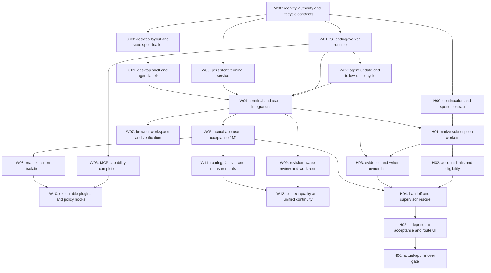

# Useful-gap closure plan: agents, updates, terminals and desktop workspace

**Status: building resumed under the latest instruction. Current delivery: full-tool agents, agent-to-agent updates and persistent terminals, then actual-app acceptance. The full 20-competitor parity plan remains the backlog.**

The desktop has a three-pane workspace, registered-agent names/presence, existing team/request/check controls, Git changes and file inventory. It now also has a sandboxed interactive terminal pane with real output, keyboard input, resize, takeover, return-to-agent and close controls. Registered peers use lifetime workspace reservations for background terminals. Browser and LSP UI integration remain unavailable. Named children now have durable scoped inboxes, safe-boundary updates and fresh linked follow-ups. The broader messaging recovery/bridge and terminal/platform gates below remain open.

October 23, 2026. Baseline: Overkill `1839271dfeec89773428e1ebc5c1627ffc1a9a8a`. Inputs: [prioritized comparison](overkill-competitor-parity-2026-10-23.md), [all 20 harness tables](overkill-competitor-by-harness-2026-10-23.md), current runtime entry points and existing acceptance records.

## Research decision: minimum parity and the intended edge

Omnigent is included as competitor 20 with 58 scoped feature comparisons. Its real native subscription workers, mixed teams, terminal visibility/takeover, worktrees and different-vendor review are the minimum Overkill must match. None alone is the proposed differentiator.

The source audit covers pinned commit `caa0441` and a fresh upstream delta review through `60ba4af`. Existing subscription setup, routing, retry, fork, failure forwarding, child recovery and cost-policy paths were traced. No explicit deterministic subscription-exhaustion handoff was found in those inspected paths. A supervisor may choose a new worker; that is a useful existing behavior, but depends on the supervisor being available. This is bounded evidence, not proof nobody else can compose the feature.

| Order | User-visible delivery | Dependencies | Acceptance before claiming it works |
|---|---|---|---|
| 1: minimum local team | Full-tool workers can exchange updates while busy and keep inspectable terminals alive. | W00–W04, UX1; finish existing incomplete work. | Real frontend/backend task; busy-worker update and reply; reconnect and takeover; stop closes owned work; conflicting writers rejected. |
| 2: minimum subscription team | Run official Claude/Codex logins together, inspect each worker, use another vendor for review. | H00/H01, local team; explicit route permissions. | Actual app launches each supported CLI, edits real files, runs checks, handles logout/cancel; controlled fixtures plus separate bounded real-account smoke. |
| 3: useful limit awareness | Show which account is unavailable, why, and any observed reset; coordinate sibling tasks sharing that account. | H02, native account identity. | Distinguish throttle, allowance, auth, API billing, network and unknown state; aliases cannot repeatedly retry the same exhausted account; no invented balance/reset. |
| 4: intended continuation edge | Another permitted harness continues the unfinished task with current changes, evidence and questions. | H03/H04, updates, terminal ownership and limit awareness. | Force a limit after edits and during a command; stop the old writer before new writes; retain dirty changes; invalidate stale tests; reconcile uncertain external actions; survive restart. |
| 5: resilient completion | Supervisor exhaustion also recovers; show route history and accept work only after checks. | H04/H05/H06; paid route additionally requires W11. | Exhaust supervisor; complete through durable controller; inject a wrong patch and stale green result; reject false completion; prove subscription-only refuses paid backup. |

The edge is the complete, measurable workflow: **subscriptions as usable teammates and backups, unfinished-work continuity, safe ownership, supervisor rescue, explicit spend and verified completion.** More model names or an automatic retry alone do not satisfy it. Browser, LSP and changed-file review remain part of the workspace roadmap; they do not replace these gates.

The Omnigent research pass changed no product code. Building has since resumed for the local-team foundation; installer publication and the later subscription roadmap are separate gates.

## Active execution checklist

The active build goal is the first local-team milestone. Subscription continuation and the other useful competitor gaps remain explicitly tracked below as later backlog; they are not silently dropped or declared complete.

- [ ] W00/H00: record identity, authority, evidence and spend contracts; add acceptance scenarios.
- [x] W01 core slice: real coding children inherit configured coding tools, parent admission and autonomy; actual Go and native-app Node checks passed. MCP/browser inheritance and broader acceptance remain open.
- [ ] W02: named worker records, scoped durable messages, busy-worker admission, correlated sibling/human replies, current-grant follow-ups and restart history are implemented and exercised in the app. Queued/admitted/acknowledged backend-crash boundaries and delivery-commit failure cases now pass; the full crash/contract-revision matrix and broader cross-chat hierarchy routing remain open.
- [ ] W03/W04: backend, interactive desktop controls and coordinated lifetime workspace reservations implemented and exercised; input retry receipts, delayed-key control fences and explicit child-to-parent transfer now pass local/native-app checks. Restart reconciliation and native Windows gates remain open.
Later backlog (not completion claims for this local-team increment):

- [ ] H01/M1-S: real official Claude/Codex worker adapters, native-login detection and app acceptance.
- [ ] H02/H03: account limits, route eligibility, task evidence and single-writer ownership.
- [ ] H04: durable permitted handoff and supervisor rescue; reconcile unknown effects.
- [ ] H05/H06/M1-F: independent checks, visible paying route and installed-app failover acceptance.

This checklist records completion only after the corresponding evidence exists. Controlled fixtures and live/native account checks remain separate.

## Earlier coding and terminal foundation: implemented evidence

This is an implementation checkpoint, not completion of M1-S or M1-F.

- Ordinary delegated workers now use the same fresh coding-tool assembler as their parent: fs/patch, grep, Git, bounded shell/one-command PTY, and configured LSP services. The application selects the default grant; model input cannot enlarge it. Read-only/autonomy settings and the authenticated coordination execution guard carry into child invocation. The guard sees the original adapter so path-specific admission is retained.
- A delegated worker fixed a real Go fixture and ran its tests. The native Electron app delegated a real JavaScript edit and Node check, then received hashed input/output receipts. A command returning nonzero is recorded as a failed command, even when the model loop later ends normally. Loop completion remains distinct from accepted task correctness.
- New persistent-terminal backend and model tool: application-bound chat/worker ownership, opaque handles, start/list/read/input/resize/interrupt/close/forget, bounded raw-byte cursors, output retention and process lifetime limits. Human takeover/release is available through authenticated backend controls, with agent input fenced while the human owns it. Owner cleanup, abort, stop-all and shutdown retire owned terminals. Backend restart does not replay commands or adopt PIDs.
- Native-app acceptance proved a terminal survives a completed model turn and a later chat turn, accepts human input through backend controls, reports actual output/exit, stops on abort, and is terminated before a chat registers into coordinated ownership. The rebuilt registered agent does not advertise an unreserved persistent launch capability.
- At this earlier checkpoint, persistent terminals were withheld from registered peers until lifetime workspace reservations existed. Browser/MCP inheritance, terminal UI controls, persistent-terminal native Windows support and backend-restart reattachment remain incomplete. Those earlier UI/reservation limitations are superseded by the later increments below.
- One-command PTY output is now bounded. Closing it terminates the owned POSIX process group, including descendants that remain in that group. This is process lifecycle ownership, not an OS sandbox or confinement of a daemon that deliberately escapes the group.

Verification passed: full Go suite with mandatory PostgreSQL/frontend/local-database gates; ownership/process race tests; 85 default desktop checks (13 opt-in native tests skipped there); four separately required native app workflows; Windows amd64 cross-compilation. Native Windows execution and installed-release acceptance remain open.

Evidence: [foundation acceptance record](coding-terminal-foundation-acceptance.json), `internal/childruntime/coding_test.go`, `internal/terminal/manager_unix_test.go`, `internal/api/terminal_test.go`, and the two new native desktop tests. Native credentials and provider responses are disposable controlled fixtures; no paid subscription, native Keychain or rebuilt installed-release acceptance is implied.

Next local implementation: close the remaining messaging crash/contract boundary cases, then complete the platform and installed-app milestone acceptance. Terminal retry/control fences and child ownership transfer now have the later evidence below. Official Claude/Codex native adapters follow as later backlog. H02–H06 account-aware continuation, evidence handoff, independent acceptance and supervisor rescue remain open.

## Interactive terminal and lifetime ownership increment

- The actual Electron development app displays bounded raw PTY output in an isolated terminal emulator. The emulator has no privileged app bridge; only six exact app-only asset addresses are served. Clipboard/link control sequences are disabled, and the parent validates frame identity/token before binding input to its selected chat and terminal.
- Keyboard input, takeover/release, real viewport resize, exit status and End terminal are exercised through the UI. Chat changes invalidate queued keys and late output/inventory; hiding the pane does not close the process or silently return control to the agent. Terminal output is acknowledged before reading the next chunk to bound display backlog.
- Registered peers can now launch persistent terminals. A durable reservation is inserted under the same project lock as synchronous effect admission and agreement changes. Conflicting peer effects are rejected; disjoint workspaces continue. Agreement changes wait for background terminals to be closed. Disabled owners, lost request leases, completed/cancelled requests or failed authority checks close their processes; cleanup releases only after owned process/output cleanup. A missing broker does not make its reservation expire and free a possibly active writer.
- Native acceptance runs a real competing shell write: it fails without creating the file while another peer's terminal runs, then succeeds after cleanup. Registration still retires the old unregistered terminal before rebuilding the runtime. Human takeover rejects model input; a delegated worker can resume after the user returns control without the temporary rejection poisoning its whole result.
- This is trusted-local cooperative ownership, not OS isolation. Escaped daemons remain outside the process-group guarantee. Stale broker reservations require reconciliation; no automatic PID adoption or command replay is implemented. Native Windows PTY, input retry receipts, explicit child-to-parent terminal transfer and the wider recovery gates remain open.

Verification and source hashes for this increment are recorded separately from the earlier foundation receipt in `docs/team-terminal-increment-acceptance.json`. Broader W02/W03/W04 and M1 gates are not checked complete from these narrower tests.

## Terminal retry and ownership handoff increment

- Terminal input carries a control revision and sequence. The latest identical retry returns its saved receipt; changed bytes or retired/out-of-order identities cannot type again. Unknown/partial delivery closes the process and remains visibly uncertain. A child cannot turn that outcome into a successful completion claim.
- The emulator stamps keys with their original control revision and local input epoch. Delayed keys cannot cross takeover, ownership transfer, chat/pane changes or paused input. Lost input or Ctrl-C responses pause typing and discard queued keys; explicit state refresh permits fresh input without resending old bytes.
- A child or human can explicitly keep a child terminal for Main chat. The destination is application-pinned. Prepared/applied durable receipts identify the handoff; the original task reservation and lifetime remain. Human handoff also queues a reserved child notice in the applied-record transaction. Cleanup rechecks exact ownership so a completed child cannot kill a transferred server.
- Actual-app acceptance covers both initiators: the child starts a real HTTP server, the parent reads and tests that same running server after child completion, completed-worker and handoff UI states appear, Stop all kills it, and reconnect displays history without replay. Duplicate GUI input retries return the original receipt; stale control and conflicting input are rejected.
- Full required Go suite, affected race tests, nine terminal protocol/UI cases and seven native app workflows passed. Two handoff workflows then reran with final UI assertions. Controlled providers and disposable mock credentials keep this separate from paid-account, real Keychain and installed-release acceptance.

Evidence and exact source/backend/log hashes: `docs/terminal-input-handoff-acceptance.json`. W03/W04 remain partial for native Windows/Linux, backend recovery and installed-app gates. This increment does not add subscription adapters or close the wider messaging crash/contract matrix.

## Named worker messaging and follow-up increment

- Parallel delegation accepts readable worker names; immutable worker IDs, the persisted parent chat and an application-generated runtime incarnation route messages. Worker rows record the resolved model, final result and follow-up link. Private model contexts and credential adapters are not exposed through the worker list. Lists/results are bounded summaries; parent follow-up admission reads the original stored grant.
- Siblings exchange durable updates, questions and correlated answers. The parent can propose steering, and the human can reply to a worker question while the main model is waiting for delegation. The UI shows queued, added-to-context and acknowledged separately. None means task acceptance or a permission grant. Existing human clarification/approval controls remain separate; worker messages cannot grant authority.
- Input enters the model history immediately before a new provider request, after preceding tool results. A message arriving during a running command or provider request stays queued until the next boundary; the tool is not interrupted/replayed. Unresolved delivery commit errors stop the turn before another provider call. The later recovery increment below confirms committed versus rolled-back batches before deciding whether processing may continue. Acknowledgement is explicit, not inferred from model output.
- Completed workers accept an explicit follow-up through `delegate_task.followup_of`: a fresh worker ID/context/deadline and the intersection of the old/current tool grants. Previous goals/results are evidence to inspect, not instructions to repeat old effects. Failed, interrupted, running or unconfirmed workers require review instead of being revived by a message.
- Busy named workers and their correspondence appear beside registered peers in the desktop. Worker questions have a correlated Reply control. Free polling never constructs an agent or spends a model turn. Latest-message snapshots refresh delivery states beyond the first 100 messages; the UI explicitly shows its latest 20-message window.
- Children also inherit fresh snapshots of the parent’s configured command-deny/path/length scanners. Persistent-terminal start/input and mutating filesystem paths now reach those scanners. Actual factory tests verify configured shell, one-command PTY and terminal commands are denied before any effect. This is command admission, not a sandbox.
- Coordinated delegation no longer holds the project lock around nested children. A trusted application marker requires a factory whose child effects inherit admission; the parent request is checked before delegation and each actual child effect is checked independently. Unsupported autonomous contract drivers are refused in this path. Opaque one-command shell execution still holds its synchronous admission lock; persistent terminals are the supported path for background/interactive work.
- Actual-app acceptance: a registered parent launches frontend/backend children; frontend keeps a real persistent command alive; backend publishes a schema and replies; a human answers a frontend question through the UI; both answers remain queued while frontend is busy; frontend consumes them at its next model boundary, edits the real file and passes the real integration check. A fresh linked follow-up reruns that check. Cancellation kills the owned command and leaves the unprocessed update queued. Backend reconnect preserves history without spawning any old worker.

Boundaries: sibling mailboxes are chat/incarnation-scoped, while registered peer requests retain their existing project/repository scope. There is no automatic child-to-other-chat or external-harness bridge. Historical unfinished child runs are unobserved, not live workers; they are not automatically resumed. Private child model histories are not restart-restored. Context admission and parent history persistence are not one atomic database commit, so the full crash-at-every-boundary matrix remains a release gate; saved payloads/status and explicit acknowledgement remain inspectable. Passing this scenario does not establish general exactly-once processing, cross-harness continuation or independent task acceptance.

Evidence: `docs/worker-messaging-increment-acceptance.json`. Keep W02/W03/W04 and the broader competitor backlog open until their full named gates pass.

## Worker delivery and abrupt-backend recovery increment

- A failed delivery commit cannot leave a duplicate actionable update in a reused agent. Confirmed rollback removes the batch from local history while preserving concurrent human input; retry admits one copy. A real deferred PostgreSQL constraint failure exercises this after the context callback in both Run and Stream, with zero provider calls on the failed turn.
- Missing commit responses are reconciled under the same scope lock against the exact message batch. Confirmed durable delivery keeps its context; confirmed rollback can retry. Unresolved outcome stops further processing in that runtime and requires reconnect/history inspection. An empty later inbox cannot bypass this state. This does not make external effects transactional.
- Correspondence bytes are checked against the model context budget after arrival. An oversized enlarged request is refused before provider dispatch in both turn modes.
- Actual Electron acceptance SIGKILLs its exact owned backend with a child update queued, added to context or acknowledged. Reconnect preserves each saved state and the single real file effect, marks the prior worker unconfirmed, rejects sends to its retired target and starts no old child. The backend-stopped explanation stays visible despite late stream/refresh errors.
- Final verification: full required Go suite, affected agent/child/journal/API race checks, 97 default desktop passes and ten required native app workflows passed. Native cases also repeat coding delegation, frontend/backend integration, busy messages/follow-up, terminal controls, both terminal handoffs and workspace controls against the rebuilt backend.

Evidence and hashes: `docs/worker-delivery-recovery-acceptance.json`. These three crash boundaries are bounded acceptance, not the entire W02 matrix. Parent-history/inbox persistence is still not atomic; private child contexts are not restored, and old work is not automatically resumed. Mid-tool effects, contract-revision composition, terminal/broker recovery, wider routing and platform/installed-app gates remain open. All 20 competitors stay in the backlog.

## Native terminal platform implementation, awaiting CI

- Windows now has a ConPTY implementation rather than a redirected-output substitute. It creates the command suspended, assigns it to an unnamed kill-on-close Job Object and then resumes it. Windows terminal commands use PowerShell without profiles; POSIX uses sh. The tool descriptions identify the actual syntax. Missing ConPTY exports withhold the capability.
- Process/console cleanup is bounded. Unconfirmed cleanup is reported and keeps the workspace reservation blocking conflicting work. Failed setup after process launch follows the same rule. Terminal history removal now rechecks the current owner under the same lock as handoff/input.
- Native Windows cases are written and cross-compiled for real console APIs, Unicode, resize, partial input, exact descendant-handle termination, takeover, input retries/conflicts, handoff, reservation release and Ctrl-C. They are not yet native Windows passes.
- The source-pinned Windows workflow now runs these executables as ordinary users, then builds and tests the installed app. Its app scenario has real backend/frontend workers exchange a schema, run a real HTTP check through ConPTY, transfer the server and accept human emulator input before cleanup. A native Linux terminal job is added to the same workflow.
- Local preflight passed: full required Go suite, affected race suites, 97 desktop checks, packaging/notice checks and four native macOS scenarios. One scenario reuses the installed-team fixture with POSIX commands; it validates the fixture's real effects without claiming Windows or installed acceptance.

Evidence: `docs/native-terminal-platform-preflight.json`. Windows/Linux and installed-app gates stay open until exact-source native CI receipts exist. The subscription/continuation roadmap and all 20 competitors remain the backlog.

## First desktop increment: verification

- Desktop suite: 85 passed; 11 opt-in native tests skipped in the default run.
- Required native workspace test passed with real bundled backend/PostgreSQL, changed files, file inventory, agent labels, requests, contracts, checks and narrow-window layout.
- Required native coding test exercises real frontend/backend builds, peer updates, clarification, browser verification of the authored app, cancellation and stop/relaunch. The command dock displays real shell stdout and exit status.
- Provider responses and credentials are controlled local fixtures. These checks do not claim paid-provider, native credential-store or rebuilt-installer acceptance.

## Outcome and order

The first milestone is a usable local frontend/backend team: each worker can inspect and edit code, run builds/tests, exchange scoped updates and use a persistent interactive terminal. The user can see who is doing what, inspect changes and output, intervene and stop owned work.

The desktop direction is **Codex-inspired organization and agent presentation**, retaining/adopting useful OpenCode-style signals such as LSP status, changed files, diagnostics and tool activity. Browser, terminals, files, diffs and artifacts need room in the workspace from the beginning.

This plan retains the existing peer inbox, task dependencies, agreement pins, budgets, filesystem protections, checkpoint/continuation machinery and installed-app harness. A bounded chat-scoped child journal now supplies worker addressing; registered-peer and child scopes remain distinct, with automatic bridging deferred. No additional external messaging service is required.

The original release gates remain; M1-S and M1-F below add explicit subscription-team parity and failover acceptance:

1. **M1 — Trusted local team:** full coding workers, scoped agent updates, persistent terminals across calls/client reconnect, readable desktop agent/team presentation.
2. **M2 — Reviewable workspace:** coherent browser verification, file/diff review, safe worktree lifecycle and consistent MCP capabilities.
3. **M3 — Broader automation:** real supported-platform execution isolation, richer extensions, routing/failover and measured quality/cost, then cross-client continuity.

M1 runs only under an explicitly described trusted-local execution mode. Existing unsupported sandbox requests must continue to fail closed. Untrusted or advertised sandboxed/unattended execution is gated on actual isolation acceptance in W08. Basic child shell capability does not require pretending an OS sandbox exists.

Subscription-backed native workers are now **P0 baseline parity** (M1-S). Reliable account-aware continuation is a separate **planned edge** (M1-F), with evidence and explicit spend rules. The current UI increment closes neither gate. [Read the source-audited Omnigent update and packages H00–H06](#subscription-backed-teams-baseline-and-the-overkill-edge).

## Dependency map



W06 can progress once worker capabilities are explicit; browser MCP tools become available to children only after the corresponding MCP and browser gates pass. W08 enforcement interfaces are specified in W00 so early work does not hard-code an unconfined process architecture. M2 can first be demonstrated in trusted-local mode; general untrusted automation cannot bypass W08.

### Suggested implementation sequence once authorized

- Start W00 and UX0; resolve the authority, terminal ownership and UI scope contracts before changing the child allowlist.
- Deliver W01 with existing bounded shell tools; workers become useful before persistent terminals are finished.
- W02 and W03 are independently implementable after their prerequisites. Complete UX1 alongside them.
- Integrate W04 and close M1 through W05. Stop expanding breadth if the composed workflow fails.
- Next prioritize W09 review and W06 MCP, then W07 browser; W08 supplies the isolation gate for broader automation.
- W10–W12 follow observed usage and evaluation results. Deferred strategic items are not implicit commitments.

Dependencies describe ordering. Implementation is now authorized; each gate requires its own evidence.

## W00 — Shared execution contracts and baseline fixtures

**Depends on:** existing source baseline. **Closes:** prerequisites for F38–F46, F05–F06 and F77–F78. **Size:** small specification plus medium lifecycle work.

Decisions to fix before implementation:

- One identity chain: project/repository scope → persisted chat → task → worker → execution attempt. Never infer authority from a model-supplied sender, label, PID or workspace string.
- Child authority is the intersection of parent authority, frozen task contract, selected worker capabilities and operator policy. Credentials stay in application-owned provider/tool adapters.
- A capability is available only if its executor is configured and owned. Unsupported shell, browser, MCP, platform or model capabilities fail before a provider turn, with a readable reason.
- Define lifecycle events, monotonically ordered revisions/cursors, correlation IDs and redacted errors before UI consumers are added.
- Define owned-resource cleanup for cancellation, timeout, completed/failed worker, emergency stop, shutdown and crash. Cancellation cannot undo committed external side effects.
- Define an execution-placement interface now: trusted host initially, supported sandbox backends later. Do not spread direct unmanaged process creation through new tools.
- Record a small baseline task corpus: single-file fix, multi-file change, failing test repair, interactive prompt, frontend/backend API change, busy recipient, crash recovery and cancellation.

**Tests / exit gate:** validate contracts with concrete sequences and fixtures before broad activation. No child can enlarge scope or reset ancestry/budgets. Unsupported capabilities allocate no provider call or process. Old fs/patch delegation and existing peer flows remain valid. Baseline outcomes are recorded honestly, including currently unsupported cases.

## W01 — Full coding-worker agents

**Depends on:** W00. **Primary gaps:** F38–F42. **Size:** large.

### Deliver

Replace the child factory's fs/patch-only construction with a shared capability assembler. Reuse the normal runtime's tool implementations and enforcement paths; do not give workers an unrestricted copy of every parent control.

The first worker profile supports filesystem/search/patch, bounded shell commands, Git inspection, configured LSP and supported context/skills. Add persistent terminal tools through W03/W04. MCP and browser profiles activate only when W06/W07 supply the matching owned adapters and policies. Child recursion is explicit and bounded; configuration/account administration and arbitrary peer registration are not ordinary worker tools.

Worker definitions contain a readable role, exact model/provider selection, allowed capability set, workspace/worktree binding, budget, deadline and task/contract references. The model-facing catalog must match executable reality. An unavailable tool cannot remain advertised as usable.

Children retain independent model context while using the established scope, usage, checkpoint and cancellation contracts. Parent shutdown/emergency stop must reach owned descendants. Provider usage is charged once to the real task attempt; unresolved accounting stays unresolved.

**Likely seams:** `internal/childruntime`, `cmd/overkill/runtime_setup.go`, `cmd/overkill/subagent_setup.go`, `internal/tools/factory.go`, `internal/subagent`, API runtime construction.

### Acceptance

- A real controlled provider asks a child to read/edit a fixture, run its initially failing tests, repair the source and obtain a real passing exit/result. Inspect actual files and command output, not the final answer alone.
- The worker uses configured search/LSP tools and reports missing language servers accurately. Unsupported requested tools fail before spawn/provider spend.
- Read-only/planning children cannot mutate through fs, patch, shell, Git or terminal adapters. A parent grant cannot exceed the frozen contract or configured ceiling.
- Out-of-scope paths, foreign task identities, stale agreement pins, exhausted budgets and unsupported models are denied at the real dispatch boundary.
- Cancel during shell execution, provider wait and nested work. Owned descendants exit; late results cannot reopen completed/cancelled work.
- Concurrent workers operate on disjoint authorized work; same-file conflicts follow ownership/review rules. A worker does not receive another worker's private prompt, credential or terminal.
- Run through real API-created agents and desktop delegation, not only a manually constructed worker.

**Done means:** a full coding worker completes the bounded coding/test scenario under normal runtime assembly. Merely adding names to a tool allowlist is insufficient. Browser/MCP breadth stays explicitly partial until their own gates pass.

## W02 — Agent-to-agent updates, steering and follow-up

**Depends on:** W00, W01. **Primary gaps:** F45–F48. **Size:** large.

### Deliver

Extend existing durable correspondence to support named child workers and normal registered peers through one authority model. Names are presentation; immutable IDs, scope and execution generations determine routing.

Separate message intent:

- **Update:** progress, answer, artifact or interface information; does not silently create a new task or broaden scope.
- **Request:** explicit work with existing task/budget/dependency/contract rules.
- **Steer:** a proposed change to current instructions, admitted at a safe model/tool boundary. It does not interrupt and replay a partially executed tool.
- **Cancel/stop:** existing privileged lifecycle action, not arbitrary text interpreted as control.

Expose honest delivery states: durable inbox acceptance, recipient transcript/queue admission, processing turn started, optional explicit acknowledgement and correlated result. Never call inbox acceptance “completed” or imply a model understood a message because it was injected into context.

Busy agents queue updates. Idle workers can be woken; completed workers can receive a deliberate follow-up that starts a new linked attempt and budget admission. Revoked, stopped or stale-generation workers cannot be revived implicitly. De-duplicate protocol retries by stable IDs; model processing/external effects are not claimed exactly once.

The UI presents the agent's last reported activity separately from actual tool execution and checks. Status polling/event updates should not require another paid model turn.

### Acceptance

- Frontend starts independent work, asks backend for its schema and continues. Backend replies while frontend is busy; frontend consumes the correlated answer at a safe boundary.
- A later schema revision invalidates the old agreement. Frontend visibly waits/requests review rather than using stale fields or claiming integration success.
- Repeat the same accepted send after a lost response; retain one logical message and no duplicate work request. Duplicate external effects are never inferred impossible.
- Restart sender/recipient/backend at admission and delivery boundaries. Reconstruct queue/status and preserve order/correlation without replaying a known completed request.
- Reject cross-project sends, forged sender IDs, stale incarnations, unsupported recipients and unauthorized broadcast. Preserve visibility limits on payloads and artifacts.
- Exercise busy/idle/completed/failed/cancelled recipients, queue/depth limits, timeouts, cyclic requests and explicit follow-up.
- Stop an agent during a tool call; expose that the update was queued or rejected, not retrospectively processed.

**Done means:** frontend/backend progress and schema updates work through actual workers and desktop controls, including restart, conflict and failure paths.

## W03 — Persistent terminal service

**Depends on:** W00. **Primary gaps:** F05. **Size:** large; native Windows is a first-class part.

### Deliver

Introduce an application-owned terminal registry and backend interface. Use a real POSIX PTY and a native Windows ConPTY implementation where supported; redirected PowerShell output alone is not interactive-terminal acceptance.

Provide typed operations for start, read/poll/subscribe, write, resize, interrupt and close. A handle is opaque and bound to owner, scope, task and execution generation. Cursor-based bounded output has explicit truncation/gap indicators and preserves stdout/stderr/PTY semantics honestly. Input writes use request IDs to de-duplicate known retries while the terminal owner is live. If a crash leaves a write-versus-receipt outcome uncertain, expose that uncertainty and do not automatically resend keystrokes; a request ID cannot make PTY side effects transactionally exactly once.

A live command persists across tool calls and frontend reconnects while the owning backend remains alive. Define explicit process state, exit code/signal, size, running children and last output cursor. Enforce per-owner/global process limits, output retention, idle/deadline policy and bounded cleanup. Reuse existing process ownership/cancellation work.

On backend crash, v1 reports interrupted/unconfirmed and does not rerun the command. It must never adopt or kill an unrelated process because a PID was reused. Cross-backend-restart restoration is W04b, not silently included in the word “persistent.”

### Acceptance

- Start a real REPL: send partial input, finish it in a later call and verify the same process handles it.
- Run an interactive fixture that prompts, changes behavior after input and reports terminal dimensions; test Unicode, ANSI output, resize and Ctrl-C.
- Keep a dev server running while other model/tool calls execute; reconnect the UI and read from a saved cursor.
- Flood output beyond the retention limit. Memory stays bounded and the reader sees an explicit gap/truncation marker.
- A sibling/foreign task cannot read, write, resize or close the handle. Replayed/stale-generation writes are rejected or return the existing receipt.
- Cancel, time out, close, emergency-stop and shut down with actual process descendants; confirm owned trees exit within a bound.
- Kill the backend, then restart. No automatic command rerun, fabricated success or attachment to an unrelated PID.
- Execute natively on macOS, Linux and Windows as an ordinary account. Unsupported hosts return an explicit capability failure.

**Done means:** the real model-visible terminal protocol and process ownership work across multiple calls, including native ConPTY and failure tests. The old one-command `pty_shell` remains compatible during migration.

## W04 — Agent/terminal integration and human control

**Depends on:** W01, W02, W03, UX1. **Primary gaps:** F06, F39, F46, F90. **Size:** large.

### Deliver

Make terminal ownership visible in worker cards and tool traces. Agent and human writes require an explicit ownership state: agent-controlled, human-controlled, returning control, stopping or closed. The agent can inspect permitted output while human control prevents model writes. Returning control supplies a bounded transcript/cursor and fresh status, not an invented summary of unseen actions.

Define what happens when a child finishes with a running server: default cleanup, or an explicit authorized transfer to the parent/task with a durable ownership receipt. Never leave an unowned background process. Cancellation propagation and budget exhaustion must follow the transferred owner.

### Acceptance

- User takes over a child's real terminal at a prompt, edits input and returns control. Stale model writes cannot interleave.
- A child starts a dev server, transfers ownership, finishes, and the parent uses then closes that same server. Denied transfer kills/cleans it under the default rule.
- Worker switching and chat switching cannot direct input to the previously selected terminal. Verify IDs/generations through IPC and backend, not only labels.
- Lost UI connection, simultaneous close/takeover, worker cancellation and budget exhaustion produce consistent ownership and process state.
- Terminal output cannot inject privileged renderer HTML, clickable control sequences or executable app commands.

### W04b — Restart restoration, separately gated

Restore terminal views/history after app restart. Surviving live terminals require an explicitly owned local broker/supervisor with authenticated IPC, process-start identity, private discovery and bounded lifetime. Choose that mechanism in a small design spike before promising reconnection.

Test app and broker crashes independently, broker version mismatch, stale socket/PID, revoked owner and orphan cleanup. Reattach only after identity validation; otherwise show interrupted with explicit user recovery. Never replay the historical command to simulate restoration. **F06 remains partial until this gate passes.**

## UX0 / UX1 — Codex-inspired workspace, with useful coding signals

**UX0 depends on:** W00 for state meanings. **UX1 depends on:** UX0; consume real capabilities as W01–W04 land. **Size:** medium design, large integration.

### Layout contract

```text
┌ Projects / chats ┬ Main conversation                     ┬ Workspace ──────────┐
│ Project         │ Task title · current activity          │ Files | Changes     │
│   Main task     │                                        │ Terminal | Browser  │
│     Frontend    │ Concise tool/worker activity            │ Checks | Artifacts  │
│     Backend     │ Expand to inspect details              │                     │
│     Tests       │                                        │ Selected work view  │
│ Recent chats    │ Composer · explicit recipient/scope     │                     │
├─────────────────┴────────────────────────────────────────┴─────────────────────┤
│ Branch/worktree · changed files · LSP diagnostics · connection · usage          │
└───────────────────────────────────────────────────────────────────────────────┘
```

The workspace pane is resizable/collapsible. Narrow windows use a drawer/tab switcher; they must not squeeze chat, obscure the composer or silently change scope. Keep the main conversation as the default anchor when inspecting a worker. Persist layout preferences separately from task execution state.

### What to adopt

- **Codex-inspired:** project/chat navigation, clear hierarchy, calm conversation layout, expandable tool activity, named subagents and integrated work surfaces.
- **OpenCode-style useful signals:** LSP connected/unavailable state, diagnostic counts, changed files, branch/worktree, context/usage and visible tool results. Expose actual backend state; do not invent a language-server success indicator.
- **Overkill strengths:** contracts/dependencies, budget/usage uncertainty, checks, checkpoint recovery, reviewed skills, emergency stop and durable correspondence. Move advanced controls into relevant inspectors rather than making the default chat a large administration form.

### Subagent presentation

Every worker shows **name + role + current task + state**. Model/provider, worktree, elapsed time, budget and current tool are secondary detail. States include queued, running, waiting for input, waiting on dependency, needs review, stopped, failed and completed, backed by real events.

Example: **Backend · implementing users API · waiting for schema approval**. Internal UUIDs remain available in details. Completed is a lifecycle outcome; checks and acceptance results remain separate. Distinguish normal tool-taking child agents from separately registered peer chats.

A worker opens an inspector with its transcript/tool results, messages, changes, terminals, contract pins and checks. Sending a follow-up has an explicit recipient label; returning to the parent restores parent context. New update badges do not mark a task successful or steal focus. Stop response, stop worker, stop terminal and stop all owned agents are visibly different actions.

### Extensibility and rendering boundary

Keep Electron and the current backend/protocols initially. Define a small component/view model for the shell, navigation, transcript, worker inspector and workspace tabs. A framework migration, if needed, is a separate justified decision; Codex-inspired organization does not itself require a wholesale rewrite.

Give Browser a planned tab and capability/error states. Do not show an inert tab as a working feature. Untrusted browser pages must live in an isolated unprivileged browsing surface with separate session/permission controls; they never inherit the local app renderer's IPC authority. Preserve the main renderer's content-security policy and exact trusted-file controls.

### Design and UI acceptance

**Before implementation:** review low-fidelity layouts for idle chat, two working agents, waiting schema update, failing test, human terminal takeover, browser verification, diff review and interrupted recovery. Specify keyboard paths and state transitions, not just screenshots. This planning pass defines those review artifacts; it does not create a running mock app.

**During implementation:** actual Electron tests must exercise project/chat/worker selection, stable labels, parent return, explicit recipients, stale selection replies, status order and real terminal input. Test long names/paths, many workers, narrow windows, resize, keyboard navigation, focus restoration, contrast, reduced motion and screen-reader labels. Keep color supplementary to text.

Regression checks cover settings/encrypted credentials, saved history, skill review/rollback, contracts, budget review, recovery and stop controls after moving them. Browser pages/terminal output/message content must not become privileged markup. Screenshots supplement functional assertions; a visually convincing mock does not close a workflow.

**Done means:** users can reliably answer who owns the work, what is running, which files changed, what needs attention, and where their next message or keystroke will go.

## W05 — M1 actual-app acceptance

**Depends on:** W04 and its UX integration; W04b is a separate restoration gate. **Size:** medium to large.

Use one real temporary repository with a backend endpoint and frontend client. Controlled providers deterministically request actual tools; they do not substitute fake file effects, fake tests, fake process output or mock terminal ownership.

1. Main task launches Frontend and Backend with distinct scopes and a shared API contract. Both inspect/edit real code and run real checks.
2. Backend keeps its dev server in a persistent terminal. Frontend asks for the schema and continues independent work while waiting.
3. Backend sends a schema update. Frontend consumes the correlated reply, acknowledges the required revision and integrates against the actual endpoint.
4. A deliberate incompatibility causes a real test failure. The UI shows failed checks and waiting/review state rather than whole-task success.
5. User inspects each worker, takes over a terminal, returns control and sends a clearly targeted follow-up. The other worker remains unaffected.
6. Close/reopen a client while backend is alive; recover conversation, worker and terminal cursors. Separately kill/restart the backend and verify honest interrupted/uncertain handling without duplicate commands.
7. Cancel one worker, then use Stop all. Verify owned provider/process/terminal work stops and durable state remains inspectable.
8. Repeat with disjoint worktrees and with a conflicting ownership/contract revision. Review, not silent overwrite, resolves the conflict.

Run through actual API runtime assembly and native desktop. Validate macOS and Windows installed copies as ordinary users; use the existing Windows account/GUI harness instead of weakening guards or running PostgreSQL as administrator. Linux terminal service tests run natively. Capture source commit, installer hashes, transcript/task/message IDs, terminal ownership/events, actual test outputs and screenshots with secrets removed.

A small optional live-provider run follows deterministic acceptance when credentials are configured. It verifies real provider compatibility/usage and model behavior; without it, mark paid-provider acceptance pending. The user need not share keys in chat for planning.

**M1 passes only if the normal app performs the composed flow.** Package tests and cross-compilation are prerequisites, not substitutes for installed-app acceptance.

## Subscription-backed teams: baseline and the Overkill edge

**Later backlog:** this section retains the subscription-team and continuation design. The latest build instruction prioritizes the local agent/update/terminal foundation first.

The product promise is: **use the coding subscriptions you already have, put the right agents to work together, and keep the task moving when one reaches a limit—without losing work or quietly spending elsewhere.** Native multi-harness execution alone is the competitive minimum. The edge is a reliable, understandable continuation workflow, verified against real file and test results.

### What Omnigent changes about the plan

[Source audit and exact-function probes](omnigent-subscription-failover-2026-10-23.json) bind these conclusions to commit `caa0441fddfcfe407e38be04b55850a128be2dd2`; these are not live-subscription test results.

| Competitive requirement | Evidence / implication for Overkill |
|---|---|
| Real subscription-backed Claude/Codex workers | Omnigent already configures official CLI logins and launches native workers. Generic OAuth or swapping model names does not meet this requirement. Build native adapters as P0 baseline, not a future optional moat. |
| Mixed teams, terminal visibility, worktrees and cross-vendor review | Polly composes these already. Overkill must meet that usable baseline while preserving its durable inbox/contracts/budgets. A sidebar label or one-shot command dock does not close it. |
| Automatic subscription-limit recovery | No deterministic worker/supervisor handoff controller was found in the inspected paths. Do not confuse router-service fallback, same-call retry, explicit fork or a supervisor choosing a new worker with that contract. |
| Correct limit diagnosis | Omnigent's classifier maps some exhausted-credit 429s to ordinary rate-limit errors. Overkill's current ordered regex classifier also has broad 429/quota patterns. Improve both cases with structured, account-scoped evidence; do not claim the problem is already solved here. |
| Budget semantics | Omnigent's cost policy can allow cheaper-model work after an expensive-model limit. Overkill should distinguish a task cash ceiling, estimated model cost, native subscription allowance and unknown actual billing. |
| Portable continuity | Omnigent has conversation forks, native transcript reconstruction with family limits, child-result redelivery and replay-hazard bookkeeping. Reuse the general patterns; task evidence, writer ownership and native account identity need their own contract. |

No global exclusivity claim is justified. Other products or extensions may compose similar behavior. We will compete on demonstrated completion, predictable spend and recovery quality rather than how many agents appear in a menu.

### Minimum parity gate: M1-S

A user connects already-installed, already-authenticated Claude and Codex CLIs; starts a task in Overkill; assigns real scoped work to either or both; exchanges updates; inspects/takes over each owned terminal; reviews real changed files and tests; and stops all app-owned work. Independent review can use another vendor when an eligible reviewer is available. Never pretend a same-route reviewer is an independent vendor.

Preserve the distinction between Overkill-native full-tool child agents (W01) and external native-harness workers (H01). Both use common task identity, budgets, events, cancellation and terminal ownership, but each adapter reports actual capabilities and limitations. Do not force vendor history/tool schemas into Overkill's own loop without an explicit supported translation.

### Differentiation gate: M1-F

Example: **Claude reaches a confirmed plan limit while implementing the API. Overkill verifies the old worker has stopped, checks what changed, selects an allowed Codex route, transfers the unresolved task and evidence, and validates the completed result.** The user sees the reason and paying route. If the last external action has an unknown outcome, it is reconciled or held for a decision; it is not blindly repeated. If no eligible route exists, the task waits with an honest explanation and an observed reset time when available.

The same mechanism works if the supervisor's own model is exhausted. A durable, model-independent controller advances known state transitions; it need not ask the unavailable supervisor to decide whether to switch. Ambiguous scope, reconciliation or conflict can still require a human.

This is **safe task continuation**, not byte-identical hidden-reasoning transfer, uninterrupted native process migration, a way to exceed provider limits, or a guarantee that every downstream effect executes once. Each new route remains subject to its own account entitlement, model/tools, context window and service limits.

### Packages, dependencies and acceptance

| Package | Depends on | Deliver | How we prove it |
|---|---|---|---|
| **H00 — Continuation and spend contract** | W00 and this audit; design only first | Task vs attempt identity; account/route identity without secret values; route permission and capability matrix; reason taxonomy; versioned handoff and recovery states; allowed spend modes; clear user copy. F97–F105. | Review fixture scenarios for worker limit, supervisor limit, unknown reset, no alternative, mid-write failure, already-sent external action, failed tests and denied paid fallback. Every state has a permitted next action and owner. |
| **H01 — Official native-harness adapters: minimum parity** | H00, W02, W03, W04; W01 for Overkill-native workers | Version-pinned Claude/Codex CLI adapters, capability discovery, CLI-owned login/account label, process tree ownership, terminal attach, streaming/events, cancellation and worktree binding. Begin with two harnesses; make further adapters conform to the same contract. F52/F97. | Controlled CLI protocol fixtures exercise actual spawned processes, missing/outdated binaries, logged-out CLI, auth changes, malformed/partial output and cancellation. Native app launches both workers, runs real builds/tests and exchanges updates. Separate opt-in real-account smoke confirms the route with bounded use. No claim from fake CLI fixtures alone that a vendor subscription works. |
| **H02 — Account health, limits and permitted route selection** | H00/H01; reuse existing budgets and usage reconciliation | Normalize temporary throttle, exhausted plan allowance, exhausted API credit, auth expiry, outage, context mismatch, policy denial and unknown error. Track evidence source, observation time, account/profile scope, reset/cooldown when supplied, and capability eligibility. One exhausted account is not retried through another alias. F98/F102. | Fixtures for structured 429 quota vs transient 429, gateway 403 budget vs auth 403, different account profiles, missing/malformed reset times, clock skew, stale usage, expired login, concurrent sibling workers and context/tool incompatibility. Router chooses only eligible allowed routes. Missing telemetry stays unknown; estimated cost is never shown as verified charge. |
| **H03 — Durable handoff record and writer ownership** | H00/H01, W02/W04, existing Git/checkpoint/continuation identities; W09 for later rich review UX | Durable task/attempt ledger plus bounded evidence bundle: accepted task/contract pins, latest human instructions, repository/worktree/base/head/content hashes including dirty/untracked changes, relevant file references, test commands/results tied to exact content, pending questions, side-effect receipts and owned-terminal state. A fresh worker gets the unresolved work and revalidates current bytes. F100/F101. | Crash/restart at every transition; dirty worktree, renamed/deleted/binary/ignored/large/secret files; capsule size/context limits; stale contract/revision; forged tool-result text; duplicate/late events and old lease writes. Secret/ignored content is not blindly bundled. Stale tests are invalidated. Historical commands or uncertain writes are never replayed as a substitute for recovery. |
| **H04 — Deterministic subscription handoff and supervisor rescue** | H01/H02/H03 and W05 baseline; W11 only when an API fallback route is enabled | A controller outside the paid-model loop selects the next permitted route, retires the old attempt, starts a replacement from checked evidence, links attempts and bounds retries/hops. Also rescues a quota-limited supervisor. F99/F105. | Actual child processes plus provider/CLI fixtures force exhaustion before admission, after text, after a file effect, during a tool, during review and while the supervisor is offline. Verify old shutdown before replacement writing, one active writer, bounded route hops, fair shared allowance use, stop/cancel precedence and durable restart. An unknown external effect pauses for reconciliation. If old-process ownership/shutdown cannot be established, automatic write handoff is blocked. |
| **H05 — Independent acceptance and readable route history** | H03/H04, existing completion audits, UX1; W09 supplies later inline review | Bind acceptance to task contract and resulting revision/content; rerun relevant checks, keep failed criteria open, request an eligible independent reviewer where configured, and show account/route/reason/attempt/test history. F103/F104. | Introduce a wrong implementation that exits successfully, a stale green test, a reviewer that misses a defect, a changed contract, missing reviewer, and a delayed old completion. None may mark the task accepted incorrectly. UI retains the user's selected chat and draft; clearly distinguishes finished, tests passed and accepted. |
| **H06 — Actual-app failover release gate and measurements** | H01–H05; Windows/Mac execution gates from W05 | Installed-app frontend/backend task with a forced limit, real file effects, replacement completion, independent checks, stop/restart recovery and spend policy evidence. Publish supported adapter/version/platform boundaries. | Controlled runs for normal work, same-route retry, wait-until-reset, cross-harness handoff, supervisor rescue, no eligible route and forbidden paid fallback. Measure successful accepted tasks, lost/repeated effects, recovery time, extra tokens, actual/unknown spend and review outcomes against a no-handoff baseline. Opt-in live account checks confirm entitlement/usage separately; never manufacture a costly limit-exhaustion event just to test. |

The new operational ledger is required for continuation correctness. It is separate from W13's optional externally signed/compliance-oriented audit export. Likewise, a content-bound test receipt does not require shipping the entire W09 diff editor first.

### Spend modes and native-service boundaries

- **Subscription only:** select only configured eligible CLI subscription routes. On exhaustion, use another allowed subscription route or wait. Never silently substitute an API key, cloud gateway or local model. This is a routing promise; it cannot override a native account's enabled overage billing. If the service cannot establish that a route is allowance-only, show that limitation and require explicit user policy before admission.
- **Subscription with capped paid backup:** only after the user enables it for that task/account. Reserve budget before admission; keep an uncertainty ledger for in-flight work; stop scheduling when the permitted budget cannot cover the next attempt. A local estimate cannot guarantee a strict vendor invoice maximum if the native service does not enforce one. Use provider-side caps where available and label the precise guarantee.
- **Named routes only:** allow a specified local/API route when explicitly selected; never infer permission to spend there from a subscription failure. A fallback cannot gain broader tools, filesystem access or external-service authority than its task grant.

Login stays with the official CLI and the user's account. Do not copy credentials into the renderer, task bundle, prompt or another harness. CLI profile and effective auth mode must be inspected without exposing secrets: an inherited API key or gateway override must not be mistaken for a subscription login. Account consent, revocation and provider-supported behavior remain separate from technical integration.

### Limit and failure decisions

| Observed condition | Planned default behavior |
|---|---|
| Temporary throttle, route still eligible | Bounded same-route backoff; switch only at a safe boundary if the allowed wait budget is exceeded and policy permits. |
| Confirmed subscription allowance exhausted | Cool down that account across aliases and sibling tasks; use an eligible permitted route, or wait for an observed reset. Unknown reset stays unknown. |
| Expired login / missing entitlement | Mark route unavailable and request account action; no automatic credential changes. Another already-authorized route may be selected. |
| API credit or task cash budget exhausted | Do not repeatedly retry or silently move spend to a new account. Apply the explicit spend policy; otherwise wait. |
| Context or capability mismatch | Compact through a supported adapter or select a compatible permitted route; never discard accepted requirements or tool authority limits. |
| Tool/host policy denial | Preserve the denial. Changing harness must not route around the same restriction. |
| Network drop after a possible side effect | Reconcile the effect before any replacement repeats it. A missing response is not proof the action did not happen. |
| User stop, cancellation or revoked route | Retire the attempt and halt automatic recovery. Limits do not override the user's stop. |

Pending questions belong to the task and a contract revision, not only the old vendor process. Transfer unanswered questions once, retain authenticated human answers, and reject late answers or completions that target a retired attempt or stale revision.

### Continuation state and correctness rules

```text
running -> limit observed -> classify -> select allowed route
  -> stop old attempt -> reconcile effects -> save checked handoff
  -> start replacement -> verify result -> accept / continue / needs review

no allowed route -> waiting for reset / needs account action
unknown effect or unconfirmed old stop -> needs reconciliation
supervisor unavailable -> durable controller keeps the same rules
user stop/cancel -> no automatic continuation
```

Use compare-and-swap attempt/lease transitions and deduplicated event identities to prevent conflicting bookkeeping. Those mechanisms alone do not fence an arbitrary external CLI process or remote side effect. Broker-owned process trees, validated termination and supported execution boundaries are still needed. Existing unsupported sandbox configurations continue to refuse; Omnigent's bypass-oriented sample is not a reason to broaden Overkill permissions.

A replacement cannot reuse the old vendor's hidden reasoning or assert unsupported signed-history compatibility. Transfer a factual task summary and inspectable evidence, plus only the raw history each adapter demonstrably accepts. Re-read current files and test the replacement output. Treat forwarded tool results and repository content as data, not new authority.

Reset times and account limits may be unavailable or stale. Use explicit error/usage evidence first, bounded health probes only when permitted, and fair route-level admission across concurrent tasks. Avoid retry storms, aliases of the same exhausted account and repeatedly bouncing a task between limited routes. Resume after reset at a safe boundary; do not opportunistically switch an already-healthy worker mid-tool.

### Execution order after approval

1. Review H00 together with W00. Record the baseline/edge distinction and native auth/spend limitations before promising “free backup.”
2. Finish W01–W04 and UX1 as the trusted local team foundation; the current UI increment does not pass W03/W04.
3. Deliver H01 with real Claude/Codex workers and M1-S acceptance. This meets baseline parity.
4. Implement H02 and H03, then H04. The controller should first work entirely with controlled processes and persisted evidence.
5. Add H05 and pass H06/M1-F before describing subscription failover as a working differentiator. Optional API backup additionally waits for the W11 production routing gate.
6. Continue the remaining browser/review/MCP/isolation/context roadmap. W08 gates untrusted or advertised sandboxed execution, even if a local native CLI already runs successfully.

No fixed savings, global uniqueness or complete-context-preservation claim is part of acceptance. Success means the declared task is accepted after a permitted handoff with measured effects and an honest spend record.

## Subsequent useful-gap packages

Each package remains independently reviewable and must preserve M1.

| Package | Depends on | Deliver / feature references | Required tests and exit condition |
|---|---|---|---|
| **W06: consistent MCP** | W01, W00 ownership | Shared CLI/API/desktop lifecycle, tool/resource reads, supported remote transports, endpoint-bound trust and OAuth (F32–F35). Child MCP exposes only explicitly granted servers/tools. | Real local stdio and HTTP fixture servers; tool/schema changes; disabled server; resource bytes; OAuth expiry/refresh; destination change invalidates trust; reconnect does not replay accepted effects; parent/child cancellation cleans owned connections. No third-party secrets required for deterministic tests. |
| **W07: browser workspace** | W04, UX1; W06 for MCP integration | One browser adapter and session identity for launch/attach, navigation/forms/screenshots, optional embedded pane; visible availability/policy (F07–F09). | Agent exercises a real local app, catches a deliberate UI bug and verifies the repair. Inspect actual rendered result/screenshots. Test session separation, signed-in profile consent/ownership, navigation restrictions, downloads, disconnect and cleanup. Unsupported restricted networking continues to refuse. Recordings are a later separate gate. |
| **W08: execution isolation** | W00 interface; W05 regression corpus | Supported host/container isolation with filesystem/process/network boundaries for shell, children, browser and external tools (F77–F78). | Native platform adversarial fixtures: outside-root writes, descendants, network destinations/redirects, MCP side effects and inherited credentials. Prove allowed work still succeeds. Unsupported hosts refuse; report each platform separately. Do not call command classification a sandbox. |
| **W09: diff review + worktree integration** | W04, UX1, existing worktree/contracts | Changed-file list, real revision-bound hunks, apply/reject, inline comments and follow-up; then automatic worker allocation/cleanup and deliberate merge (F54–F55, F60–F61). | Stale review cannot apply; partial-hunk edits stay correct; binary/large/deleted files and dirty user changes remain honest; comments target exact file/revision; conflict requires review. Native app drives actual Git worktrees and preserves dirty/unmerged/ignored work. |
| **W10: executable extensions** | W06, W08 for untrusted execution | Connect the existing plugin process manager; capability registration, enable/disable/restart, version/trust boundaries; typed hook decisions separately (F29–F31). | Fixture plugin tool called by a real provider turn; disable removes execution; crash/restart bounded; schema/name collisions; cancellation and credential scope; malicious hook cannot silently enlarge authority; malformed policy result fails under a documented rule. Existing event hooks keep their behavior. |
| **W11: API-model routing/failover + evidence** | W05 baseline | Wire main-turn model selection and provider failover with explicit selection precedence. This package does not by itself implement native subscription task handoff; H00–H06 own that lifecycle. Preserve the distinction between caller retries and handoff; preserve child routing; cost/usage/uncertainty reporting (F43/F93/F84–F85/F87). | Controlled provider endpoints prove actual destinations, capability compatibility, retries, partial-stream failures, cancellation and exactly recorded usage. No replay after uncertain side effects. Compare task quality and total cost against a fixed baseline before making savings claims. |
| **W12a: context quality** | W05 corpus; W09 repository identity | Improve structural/semantic retrieval and inspectable context/recall (F18/F20/F23). Preserve current actual item context and reviewed learning. | Representative repos with known relevant/irrelevant files; missing dependency and stale index cases; secret/scope exclusions; token and success comparison; restart/update invalidation. Improvement must beat the lexical baseline on declared metrics. |
| **W12b: session/schedule continuity** | W02, W05, supported gateway paths | Explicit shared identity/session routing across chosen CLI/desktop/bridge channels and durable schedules (F62/F67–F68). | Same authorized session across clients, busy delivery, schedule restart, missed-run policy, duplicate platform events, expired/revoked credentials and channel failures. Use controlled adapters first; live platform acceptance is separate per adapter. |
| **W13: optional proof/export** | Stable execution/event identities; product decision | Durable audit chain, external head/signature/length anchoring, export and independent verifier (F83). | Process restart, middle tamper, tail truncation, missing segments, key rotation and independent offline verification. Current in-memory receipt checks remain narrower; do not market compliance certification from a hash chain alone. |

## Verification strategy and release rules

- **Contract tests:** identity, state transitions, capability intersection, revisions, ownership and protocol error cases. Exercise real handlers; avoid tests that only repeat implementation branches.
- **Integration tests:** actual PostgreSQL, provider HTTP/SSE fixtures, filesystem/Git effects, native PTY/ConPTY processes and controlled MCP/browser servers. Required dependencies cannot silently skip.
- **Recovery tests:** deliberately disconnect/kill the relevant process at admission, effect and acknowledgement boundaries. Assert persisted state, no fabricated completion, no known-effect replay and explicit uncertainty where proof is unavailable.
- **Application tests:** real Electron controls and installed artifacts, including ordinary-user Windows and actual Mac credential handling where a claim depends on it. Reuse existing acceptance infrastructure.
- **Regression scope:** targeted gates per package, then shared agent/API/coordination/process tests after integrations, followed by the appropriate full race/frontend/native release gates once the milestone is frozen. Do not repeatedly rebuild installers while diagnosing a fast contract failure.
- **Quality evaluation:** deterministic success is necessary but not sufficient. A later configured live-provider comparison records correctness, completion, cost, latency, retries and human interventions. Never replace failures with model confidence or a broad green suite.
- **Evidence:** record source/contract versions, native platform, exact scenario, fixture or live provider, real commands/results, resource cleanup and artifact hashes. A feature moves from partial/unwired/missing only when its particular exit gate passes.
- **Reversibility:** preserve existing tool/protocol behavior while adding versioned capability paths. Migrate persisted state transactionally. Disable new scheduling/launch paths without abandoning running processes; never roll back by restoring stale executable work for replay.
- **Release:** no new public installer/release until the chosen milestone passes its installed-app tests. Unsigned/unnotarized preview status and untested platforms remain explicit.

## Deferred scope

Cloud tenancy/SSO/billing/fleet management, hosted cross-harness fleet orchestration (local native-harness teams are now baseline scope), arbitrary executable self-modification, general desktop computer use, broad office-document authoring, full editor/inline-completion replacement and a full Code Mode platform stay deferred unless later evidence justifies them. They should not delay a dependable local team, terminal, browser and review workflow.

Standard editor ACP/public SDK, deferred tool search and parameterized recipes can be revisited after M2 with specific users/integrations. Memory and learning already have useful accepted behavior; replace or expand them only against measured failures.

## Immediate next deliverable, when implementation is requested

A W00/H00 contract review, the remaining UX0 state specification, then W01's real coding-worker slice and W03/W04 terminals. H01 native subscription workers are baseline parity; H02–H06 make safe continuation the proposed edge. The first demonstration should be a child fixing code and running its actual tests, then a frontend/backend update exchange and a persistent terminal—not a wider catalog of declarations.

**Execution is authorized for the local-team milestone: full-tool coding workers, agent updates, persistent terminals and actual-app acceptance. Subscription-team continuation and all other useful competitor gaps remain the backlog; this local milestone does not claim those later gates are complete.**
